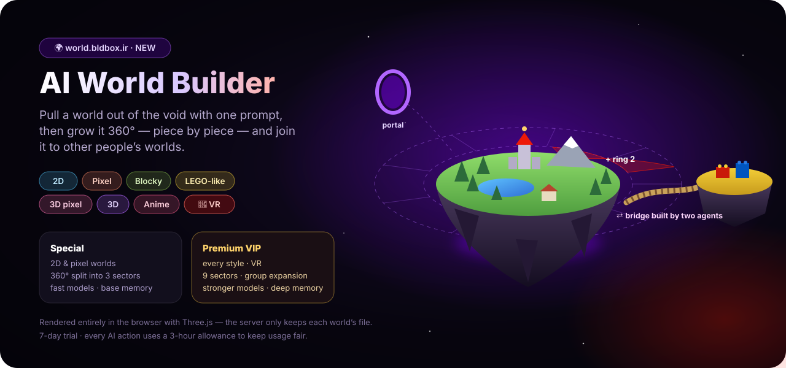

<p align="center">
  <a href="https://bldbox.ir"></a>
</p>

<p align="center">
  <a href="https://bldbox.ir"></a>
  <a href="https://world.bldbox.ir"></a>
  
  
</p>

<br>

**BldBox AI** is an AI workshop: a ChatGPT-style home where one prompt box can chat, write and run
documents, build complete apps, design custom agents, create images, hold voice conversations,
publish SEO articles and — new in this release — grow whole 3D worlds and connect them to other
people's worlds.

This repository is the **public web frontend**: Jinja2 templates, stylesheets, browser scripts and
the client-side 3D engine. Server code, the admin panel, payments, credentials and configuration
are intentionally **not** part of it.

<br>

<p align="center">
  <a href="https://bldbox.ir"></a>
</p>

<br>

## What's new in this release

| | Feature | What it does |
|:-:|---|---|
| 🌍 | **AI World Builder** | A second product on [world.bldbox.ir](https://world.bldbox.ir): build worlds in seven styles, grow them 360°, connect them to other users' worlds, explore in VR. |
| ✎ | **Blog & SEO pages** | Public `/blog` with search, tags, table of contents, reading progress, share buttons, related posts, Open Graph / Twitter cards and `BlogPosting` + `BreadcrumbList` structured data. Custom full-page HTML designs are supported too. |
| ⌥ | **Sign in with GitHub** | A *Continue with GitHub* button on the sign-in page and in the sign-in dialog. |
| 🌐 | **English everywhere** | Custom agents, BldBox Code, profiles, account, pricing and every server message now follow the chosen language, and the choice is saved on the user's account. |
| ⇤ | **Collapsible sidebar** | Close it from the sidebar header, reopen it with ☰ or <kbd>Ctrl</kbd>/<kbd>⌘</kbd>+<kbd>B</kbd>. The state is remembered and rendered server-side, so pages never flash. |

<br>

<p align="center">
  <a href="https://world.bldbox.ir"></a>
</p>

## AI World Builder

A ChatGPT-style interface floating over a deep, star-filled void. The user describes an idea, the AI
creates the **core island**, and the world then grows ring by ring in the direction the user picks.

**Seven styles, one world format.** Every world is stored as compact JSON *section specs* — terrain
features, palette, water, weather, object clusters, a landmark and an "edge" note for continuity.
The browser turns those specs into geometry with Three.js, so the server only keeps each world's file.

| Family | Styles | Rendering |
|---|---|---|
| Flat | **2D**, **Pixel art** | Top-down orthographic view with baked hill-shading; pixel art renders at low resolution and scales up with nearest-neighbour filtering. |
| Blocks | **Blocky**, **LEGO-like**, **3D pixel** | Instanced cubes on a grid; LEGO adds studs, glossy plastic and a brick colour palette; 3D pixel uses a finer grid and pixelated output. |
| Smooth | **3D**, **Anime** | Height-mapped terrain with soft shadows and fog; anime uses toon shading and ink outlines. |

**360° expansion.** The ring around the core is split into **3 sectors** (Special plan) or **9
sectors** (VIP). Pick a direction on the compass or by clicking the glowing ghost ring around the
island; VIP can also grow several directions at once in one coherent band. The last ring of each
direction can be undone.

**Connecting worlds.** Two worlds join only when both owners approve, and each owner sets the most
they allow — the lower level wins:

| Level | Allowed between | Result |
|---|---|---|
| Portal | any two styles | A glowing gate at the chosen edge; click it to travel. |
| Bridge | the same family, or Blocks ↔ Smooth | Two builder agents — one per world — design a bridge that blends one world's look into the other's. |
| Merge | the same family | The neighbouring world is placed edge to edge with yours. |

**Virtual reality.** 3D styles offer an *Enter VR* button (WebXR) when a headset is available: stand
on the island and teleport by pointing a controller at the ground.

**Plans.** A limited 7-day trial, then *Special* (2D and pixel styles, 3 sectors, lighter models,
basic world memory) or *Premium VIP* (every style, 9 sectors, group expansion, stronger models, much
deeper world memory, VR). Every AI action also uses a 3-hour allowance to keep usage fair. Accounts,
sign-in and payments are shared with BldBox.

<br>

<p align="center">
  <a href="https://bldbox.ir/code"></a>
</p>

## Repository layout

```text
templates/
  base.html              shared <head>, header/footer, theme, i18n strings, site verification
  chat.html              home page: ChatGPT-style chat, guest mode, voice, web search
  _sidebar.html          tools, chat history, account menu, collapse button, language switch
  _login_modal.html      phone sign-in (OTP) + Continue with GitHub
  _gh_button.html        "Continue with GitHub" button (shared)
  login.html             password / SMS sign-in, registration
  agents.html            custom agent builder (pipeline of capabilities, knowledge, model)
  code.html              BldBox Code: build apps from a prompt, live preview, ZIP export
  profile.html           GitHub-style public profile with activity heat-map
  account.html  pricing.html  payment_result.html  _plan_cards.html
  blog_list.html         /blog — search, tags, pagination, RSS link
  blog_post.html         article page — cover, TOC, schema.org JSON-LD, share, related posts
  world/app.html         AI World Builder app shell (sidebar, composer, compass, panels)
  world/pricing.html     World Builder plans
static/
  css/app.css            brand palette, components, GitHub button, scrollbars, code boxes
  css/shell.css          app shell: sidebar (incl. collapsed state), composer, message layout
  css/code.css  css/agents.css
  css/blog.css           blog list, article typography (.post-body), TOC, share bar
  js/chat.js             streaming answers, guest store, dictation, voice conversation, previews
  js/shell.js            sidebar drawer + desktop collapse (cookie, Ctrl/⌘+B), sign-in modal
  js/agents.js           agent pipeline editor (English / Persian)
  js/code.js  js/app.js  project files, sandboxed preview, Markdown, syntax highlighting
  world/engine.js        Three.js world renderer: 7 styles, terrain, objects, bridges, portals, VR
  world/app.js           World Builder UI: worlds list, composer, compass, explore, connections
  world/world.css        World Builder styles
  vendor/three/          three.module.min.js r170 + OrbitControls + VRButton (vendored, no CDN)
  vendor/                marked · DOMPurify · highlight.js
  fonts/  img/  brand/   Vazirmatn, favicon, logo
```

## Design notes

- **Bilingual and direction-aware.** Every template supports English (LTR) and Persian (RTL);
  user-written text keeps its own direction (`dir="auto"`). Articles carry their own language and
  direction, independent of the interface language.
- **No third-party CDNs at runtime.** Fonts and libraries — including Three.js — are served from the
  site itself so it stays fast and reachable everywhere.
- **Client-side rendering.** World geometry is built in the browser from small JSON files; the
  server never renders 3D.
- **Accessibility.** Keyboard shortcuts, `aria` labels on icon buttons, focus moves to a visible
  control when the sidebar collapses, and `prefers-reduced-motion` disables animations.

| Palette | | | | | |
|:-:|:-:|:-:|:-:|:-:|:-:|
|  |  |  |  |  |  |

<br>

<p align="center">
  <a href="https://bldbox.ir">
    
  </a>
  &nbsp;
  <a href="https://world.bldbox.ir">
    
  </a>
</p>
<p align="center"><a href="https://bldbox.ir"><b>https://bldbox.ir</b></a> · <a href="https://world.bldbox.ir"><b>https://world.bldbox.ir</b></a></p>

<p align="center"><sub>Vazirmatn by Saber Rastikerdar (OFL) · Three.js (MIT) · marked (MIT) · DOMPurify (Apache-2.0/MPL-2.0) · highlight.js (BSD-3)</sub></p>
