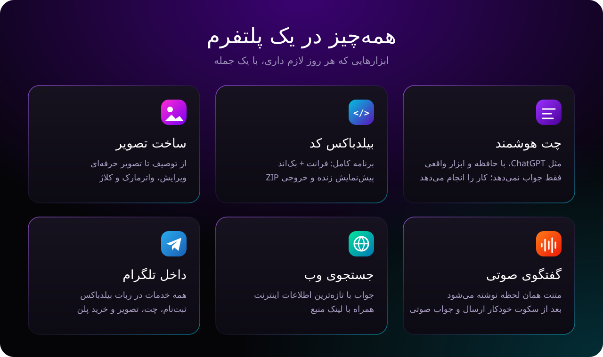
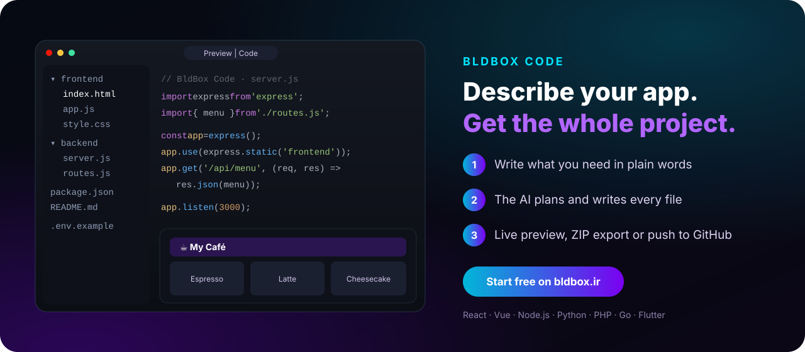

<p align="center">
  <a href="https://bldbox.ir"></a>
</p>

<p align="center">
  <a href="https://bldbox.ir"></a>
  
  
  
</p>

<br>

<p align="center">
  <a href="https://bldbox.ir"></a>
</p>

<br>

<p align="center">
  <a href="https://bldbox.ir/code"></a>
</p>

<br>

## Frontend

This repository holds the **BldBox web frontend** — Jinja2 templates, stylesheets and browser
scripts. Server code, the admin panel, payments and configuration are not part of it.

```text
templates/
  base.html            shared <head>, theme, i18n strings
  chat.html            home page: ChatGPT-style chat, guest mode, voice, web search
  _sidebar.html        tools + chat history + account menu
  _login_modal.html    phone sign-in (OTP)
  code.html            BldBox Code: build apps from a prompt, live preview, ZIP export
  login.html  pricing.html  account.html  profile.html  payment_result.html  _plan_cards.html
static/
  css/app.css          brand palette, components, neon scrollbars, code boxes
  css/shell.css        app shell: sidebar, centred composer, RTL/LTR message layout
  css/code.css         BldBox Code workspace
  js/chat.js           streaming answers, guest store (localStorage), live dictation,
                       silence auto-send, voice conversation, file previews
  js/code.js           project files, sandboxed preview, code viewer
  js/shell.js          sidebar drawer, sign-in modal, guest gating
  js/app.js            Markdown, per-paragraph direction, syntax highlighting, copy/download
  fonts/  vendor/      Vazirmatn · marked · DOMPurify · highlight.js
```

| Palette | | | | | |
|:-:|:-:|:-:|:-:|:-:|:-:|
|  |  |  |  |  |  |

<br>

<p align="center">
  <a href="https://bldbox.ir">
    
  </a>
</p>
<p align="center"><a href="https://bldbox.ir"><b>https://bldbox.ir</b></a></p>

<p align="center"><sub>Vazirmatn by Saber Rastikerdar (OFL) · marked (MIT) · DOMPurify (Apache-2.0/MPL-2.0) · highlight.js (BSD-3)</sub></p>
